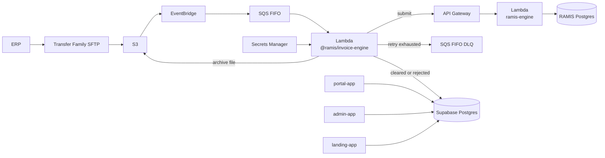
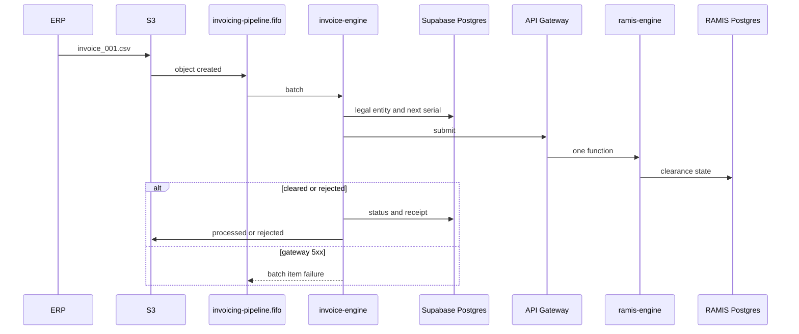

# Architecture

The ingestion pipeline runs on AWS. Supabase is the application database, authentication, and the database behind the portals. Supabase cannot host the SFTP, FIFO, and queue-triggered worker path.

## Why the pipeline is not on Supabase

* **No managed SFTP.** Supabase Storage has no SFTP endpoint. An ERP cannot connect with SSH keys and drop files into a bucket.
* **No SQS FIFO equivalent.** `pgmq` queues inside Postgres bloat tables, saturate connections, and do not lock a message group the way a FIFO queue does.
* **No queue-triggered compute.** Supabase Edge Functions run from HTTP or webhooks. They do not poll a FIFO queue with batching, concurrency limits, and a dead-letter queue the way Lambda does with an SQS event source mapping.

Amazon Aurora, Cognito, and App Runner are not part of this system. Postgres, Auth, and Row-Level Security stay on Supabase. The Next.js apps stay in this repo.



## AWS pipeline

| Tier | Service | Role |
| --- | --- | --- |
| SFTP ingestion | AWS Transfer Family | Managed SFTP. ERP SSH keys land in `/uploads/{organization_id}/{legal_entity_id}/inbound/`. |
| Storage | Amazon S3 | Object-created events for `.csv` files only. `.csv.tmp` uploads are ignored. Sibling prefixes: `processed`, `rejected`, `acknowledgments`. |
| Routing | Amazon EventBridge | Forwards a created-object event into the FIFO queue. |
| Sequencing | Amazon SQS FIFO `invoicing-pipeline.fifo` | `MessageGroupId = {legalEntityId}:{branchCode}` so one branch of one legal entity is strictly ordered. `MessageDeduplicationId` is the file SHA-256. Visibility timeout is 5 minutes. |
| Worker | AWS Lambda `invoice-engine` | Event source mapping, batch size 1 to 5. Runs `@ramis/invoice-engine`. Parses the file with that legal entity's field mapping, checks TIN, dates, and VAT, allocates the Gazette serial in Supabase, and posts to the RAMIS engine through API Gateway. |
| RAMIS stand-in | AWS Lambda `ramis-engine` | One function behind an HTTP API. Every route is handled by `handler` in `tools/ramis-engine/src/lambda.ts`. |
| Certificates | AWS Secrets Manager | RAMIS client certificate and private key, encrypted with KMS. `ramis_credentials.certificate_secret_arn` stores the ARN. |
| Failures | Amazon SQS FIFO `invoicing-pipeline-dlq.fifo` | Messages that still fail after 3 receives. Unparseable files and permanent 4xx outcomes are recorded as rejected before that. |
| Operations | CloudWatch and SNS | Queue depth, Lambda duration, and DLQ alarms. |

A legal entity keeps its own serial lane per branch. The FIFO group is `{legalEntityId}:{branchCode}`, not the organization id. Two subsidiaries in one organization must not share a sequence.

Webhook ingestion uses the same queue and the same worker. The job `source` is `webhook` and the body carries `payload` instead of an S3 key.

## Processing flow

1. The ERP uploads `invoice_001.csv` through Transfer Family.
2. Transfer Family writes `s3://…/uploads/{organization_id}/{legal_entity_id}/inbound/invoice_001.csv`.
3. S3 emits an object-created event to EventBridge.
4. EventBridge sends a message to `invoicing-pipeline.fifo` with `MessageGroupId = {legalEntityId}:{branchCode}`.
5. Lambda reads the message and runs `handler` from `@ramis/invoice-engine`:
   * download and parse the file with the legal entity field mapping
   * check 9-digit TINs, separate invoice and supply dates, and VAT math
   * allocate `YYMMM_QQQQ_XXXXX` in Supabase
   * POST the payload to the RAMIS engine at `RAMIS_API_URL`
6. The worker then writes state back to Supabase and moves the file:
   * **HTTP 200/201:** status `cleared`, file moves to `processed`, acknowledgment file is written for the ERP
   * **HTTP 4xx:** status `rejected` with the IRD error, file moves to `rejected`
   * **HTTP 5xx or timeout:** the worker throws, the message becomes visible again, and SQS retries. The document is not marked rejected.
7. `portal-app` reads Supabase for the clearance queue, Schedule 02 matching, and the allowance. A signed-in user's membership supplies the organization id. See Portal authentication.

`processInvoiceJob` checks that the legal entity belongs to the organization on the job. Submission to the engine is not wired yet, so the job still fails and SQS retries. The engine itself is ready to receive that call.



## RAMIS engine

`tools/ramis-engine` is the RAMIS Web API stand-in. It is one Lambda function, `ramis-engine`, invoked by an HTTP API (`payload format 2.0`). API Gateway sends every method and path to `handler`. The invoice-engine Lambda is the caller and does not import the engine.

Lambda execution environments do not share memory, so clearance state is not kept in the process. The engine uses `RAMIS_DATABASE_URL`. On Supabase that URL still points at the project, and `npm run migrate` writes the engine tables into schema `ramis_engine` of the `postgres` database. That is the database shown in the project. The portal tables stay in schema `public`.

The database holds cleared invoices, adjustments, idempotency keys, Schedule 02 approval, and the record and batch counters. A transaction takes an advisory lock on the idempotency key and the serial before it writes, so two concurrent invocations cannot clear the same serial twice or bind one idempotency key to two payloads. A rejected write rolls back. A later invocation reads the same rows.

Local `npm run dev:ramis` uses that database when `RAMIS_DATABASE_URL` is set, and an in-memory ledger when it is not. The deployed function requires the URL. Request throttling stays in the execution environment. Clearance state does not.

| Path | Role |
| --- | --- |
| `src/lambda.ts` | API Gateway entry. One handler for token, Schedule 01, Schedule 02, Schedule 04, and health. |
| `src/server.ts` | Same routes for the local HTTP server. |
| `src/postgres-store.ts` | Ledger reads and writes. |
| `migrations/` | Engine tables. `npm run migrate` pushes them to `RAMIS_DATABASE_URL`. |

`npm run provision:ramis` bundles that function, publishes it, and attaches the HTTP API. It prints the invoke URL. Set that URL as `RAMIS_API_URL` on the invoice-engine Lambda. The client secret is `RAMIS_MOCK_CLIENT_SECRET`.

## Supabase

Supabase holds operational state and serves the apps. It does not receive ERP files and it does not run the worker.

| Path | What it does |
| --- | --- |
| `migrations/0001_initial.sql` | Organizations, legal entities, branches, memberships, invoices, adjustments, serials, credentials, usage, audit log, and Row-Level Security. |
| `seeders/` | JSON seed objects exported from `seeders/index.ts`. |
| `scripts/migrate.ts` | Applies `migrations` and records each file in `schema_migrations`. |
| `scripts/seed.ts` | Inserts every seed object using `tableColumns` from `@ramis/common`. |
| `er-diagram.md` | Entity diagram for the migration. |

The Lambda handler is `handler` in `@ramis/invoice-engine`. There is no Supabase Edge Function and no database queue.

Row-Level Security is enabled on every table, and `anon` and `authenticated` have no grants. The service role bypasses that. The portal publishable key can sign a user in and cannot read tables.

Tables:

* `organizations`, `legal_entities`, `branches`, `memberships`
* `field_mappings`, `ramis_credentials`, `serial_counters`
* `outbound_invoices`, `outbound_adjustments`
* `inbound_invoices`, `inbound_adjustments`
* `invoice_usage`, `audit_logs`

## Portal authentication

`portal-app` keeps the Supabase Auth session in cookies through `@supabase/ssr`.

| Piece | Role |
| --- | --- |
| `src/middleware.ts` | Calls `auth.getUser()`. No session redirects to `/auth/login`. A session on that page, without `?error`, redirects to `/`. |
| `/login` | Redirects to `/auth/login`. |
| `src/app/auth/login` | Email and password form. `signInWithPassword` uses the publishable key in the browser. |
| `src/lib/session.ts` | Reads the same cookie session in Server Components. |
| `src/lib/supabase.ts` | Service-role client. Server only. Used for every table read. |
| `(portal)/layout.tsx` | Calls `loadPortal()` before any portal page renders. |

`loadPortal` in `src/lib/portal.ts` is the organization guard:

1. No session redirects to `/auth/login`.
2. Memberships are loaded for that `user_id`. None redirects to `/auth/login?error=membership`.
3. The organization is one of those memberships. On `{slug}.{NEXT_PUBLIC_ROOT_DOMAIN}` the slug must match the host. `localhost` has no slug, so the user's membership organization is used.
4. A host the user does not belong to redirects to `/auth/login?error=membership`.
5. Legal entity, branches, invoices, adjustments, inbound invoices, field mappings, serials, usage, and the member list are queried with that organization id and its legal entity id.

Sign out is in the sidebar. It clears the session and returns to `/auth/login`.

The browser key is `NEXT_PUBLIC_SUPABASE_PUBLISHABLE_KEY`, or `NEXT_PUBLIC_SUPABASE_ANON_KEY` when that name is set. `SUPABASE_SERVICE_ROLE_KEY` stays server-only. Seed passwords live in `supabase/seeders/passwords.json` and are applied by `npm run seed`; the portal does not read that file.

## Workspace

```text
ramis-middleware
├── apps
│   ├── landing-app          public site, port 3002
│   ├── portal-app           organization portal, port 3000
│   └── admin-app            platform admin, port 3001
├── packages
│   ├── common               @ramis/common
│   └── invoice-engine       Lambda worker
├── tools
│   ├── ramis-engine         RAMIS stand-in, one Lambda
│   └── deployment           S3, SQS, Lambda, and API Gateway scripts
└── supabase                 portal database, seed data, scripts
```

| App | Port | Role |
| --- | --- | --- |
| `landing-app` | 3002 | Public site. |
| `portal-app` | 3000 | One organization, chosen from the signed-in user's membership. Overview, invoices, Schedule 02, field mapping, branches, users, subscription. Roles come from `@ramis/common`. |
| `admin-app` | 3001 | Platform admin. |

`@ramis/common` is shared by the apps, the Lambda, and the seeder.

| Export | Contents |
| --- | --- |
| `entities` | Domain types and enums: `PortalRole`, `InvoiceClass`, `AdjustmentType`, `RamisStatus`, `MatchingStatus` |
| `models` | Snake-case row types, `tableColumns`, and row-to-entity mappers |
| `queues` | `invoicing-pipeline.fifo`, `invoicing-pipeline-dlq.fifo`, `InvoiceJob`, `invoiceMessageGroupId`, `invoiceMessageDeduplicationId`, `parseInvoiceJob` |
| `utils` | Slug, TIN, branch code, payload hash, Gazette serial formatting, `portalRoleLabel` |

An `InvoiceJob` has `organizationId`, `legalEntityId`, `branchCode`, and `source` (`s3` or `webhook`). S3 jobs include `objectKey`. Webhook jobs include `payload`.

## Commands

| Command | Runs |
| --- | --- |
| `npm run dev:landing` | Landing app |
| `npm run dev:portal` | Portal app |
| `npm run dev:admin` | Admin app |
| `npm run typecheck` | Every workspace package |
| `npm run migrate` | `supabase/scripts/migrate.ts` |
| `npm run migrate:ramis` | `tools/ramis-engine/scripts/migrate.ts` |
| `npm run seed` | `supabase/scripts/seed.ts` |
| `npm run dev:ramis` | RAMIS engine on port 8090 |
| `npm run test:ramis` | RAMIS engine tests |
| `npm run provision` | `tools/deployment/provision.sh` |
| `npm run provision:ramis` | `tools/deployment/ramis-engine.sh` |

`npm run migrate` and `npm run seed` read `supabase/.env` (`SUPABASE_URL`, `SUPABASE_SERVICE_ROLE_KEY`, `DATABASE_URL`). `npm run migrate:ramis` reads `tools/ramis-engine/.env` (`RAMIS_DATABASE_URL`). The portal reads `apps/portal-app/.env` (`NEXT_PUBLIC_SUPABASE_URL`, the publishable key, `SUPABASE_SERVICE_ROLE_KEY`, `NEXT_PUBLIC_ROOT_DOMAIN`). `npm run provision` reads `AWS_REGION`, `SUPABASE_URL`, and `SUPABASE_SERVICE_ROLE_KEY`. `npm run provision:ramis` reads `RAMIS_DATABASE_URL` and `RAMIS_MOCK_CLIENT_SECRET`. Copy `tools/deployment/env.example` and `tools/ramis-engine/.env.example` to set them.
