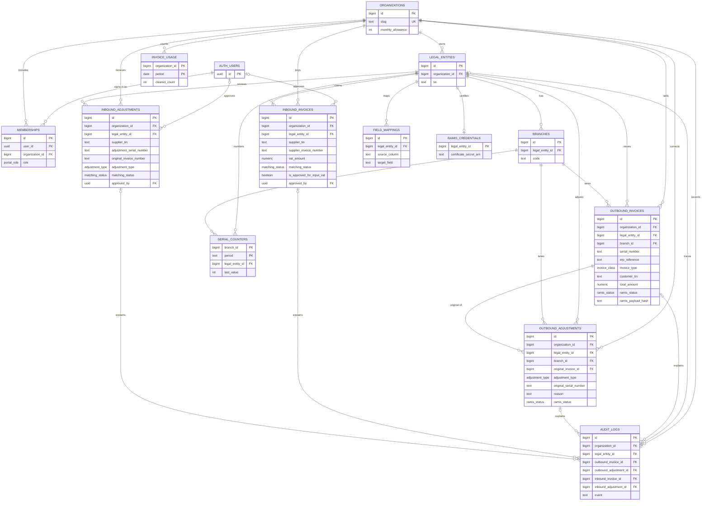

# Database entity diagram

This matches `supabase/migrations/0001_initial.sql`. A membership is one user on one organization. Legal entities and branches are business records, not permission boundaries.

`inbound_adjustments.original_invoice_number` stores the supplier's invoice number. It is not a foreign key.

